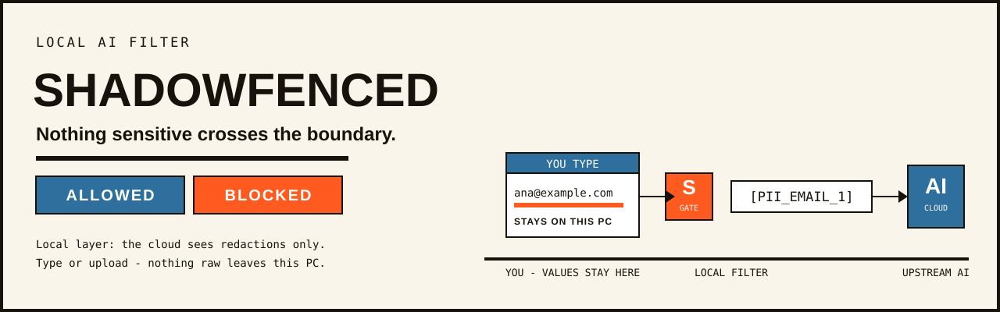
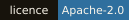
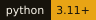
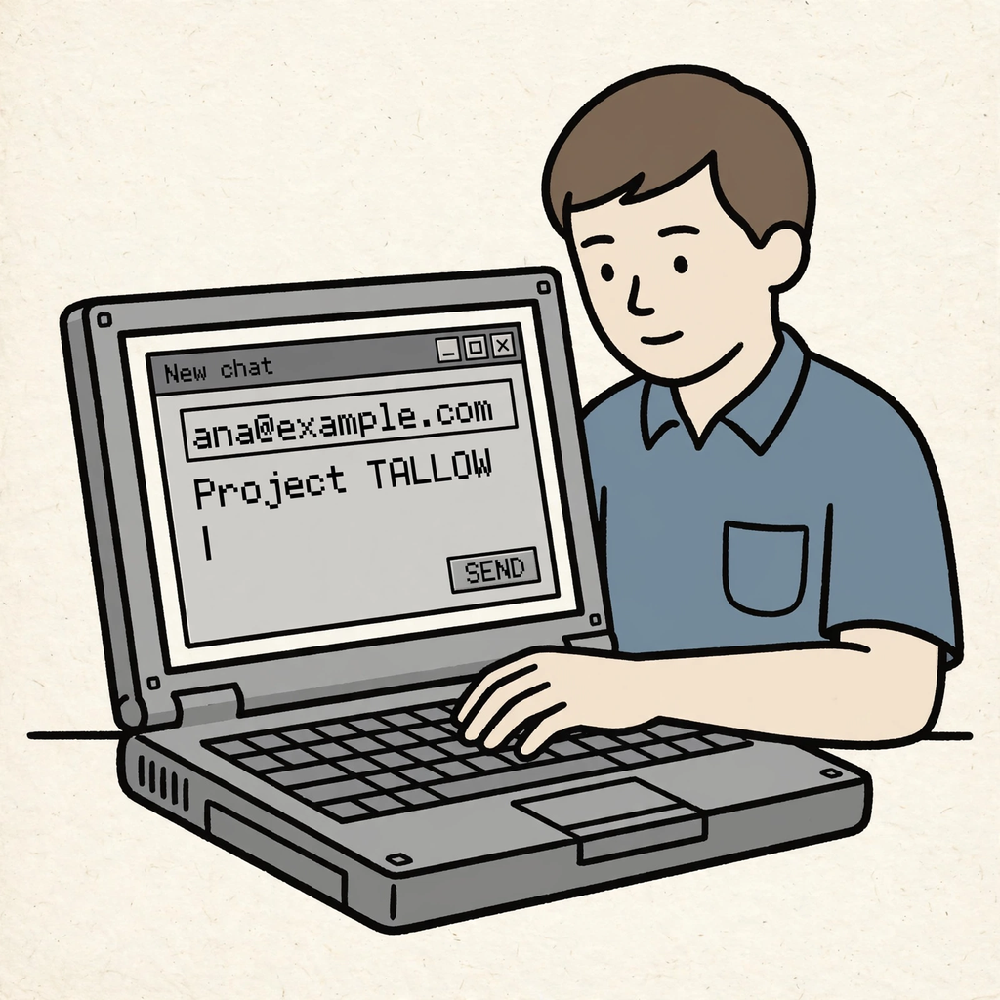
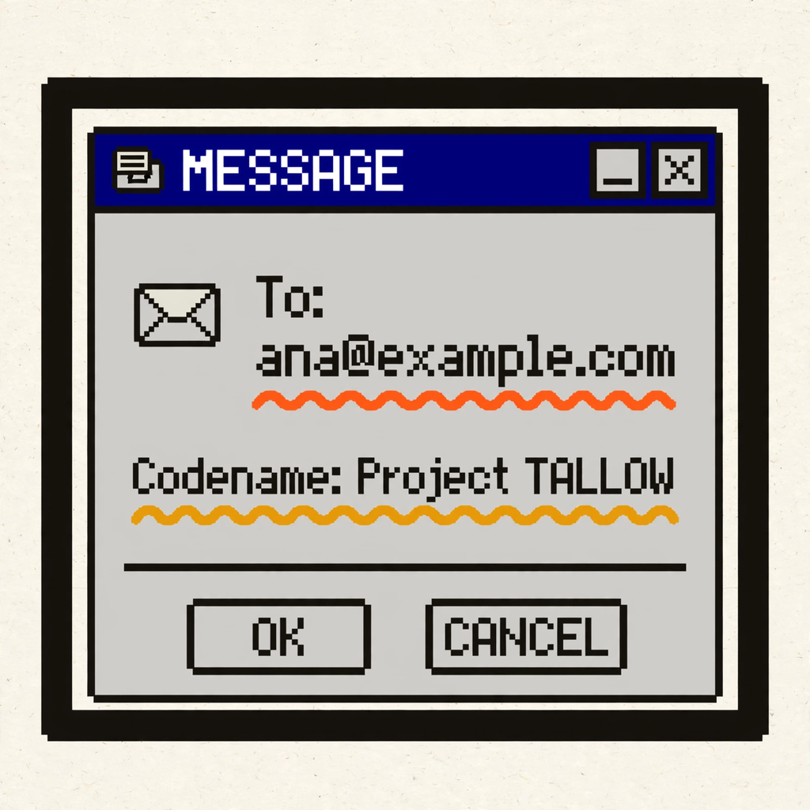
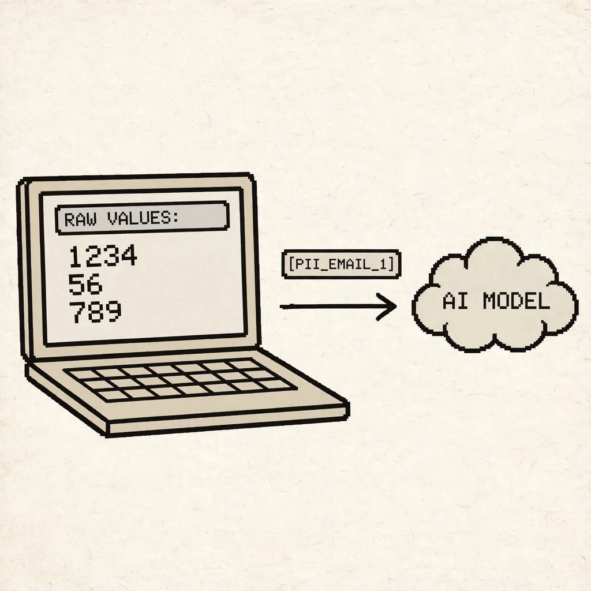
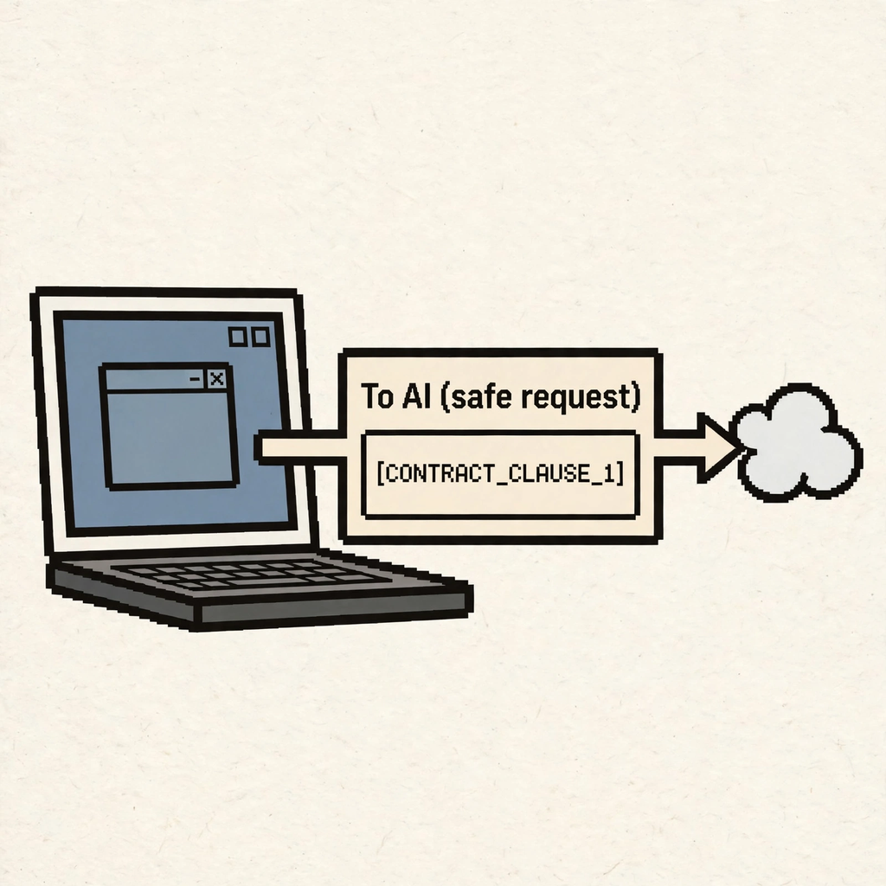
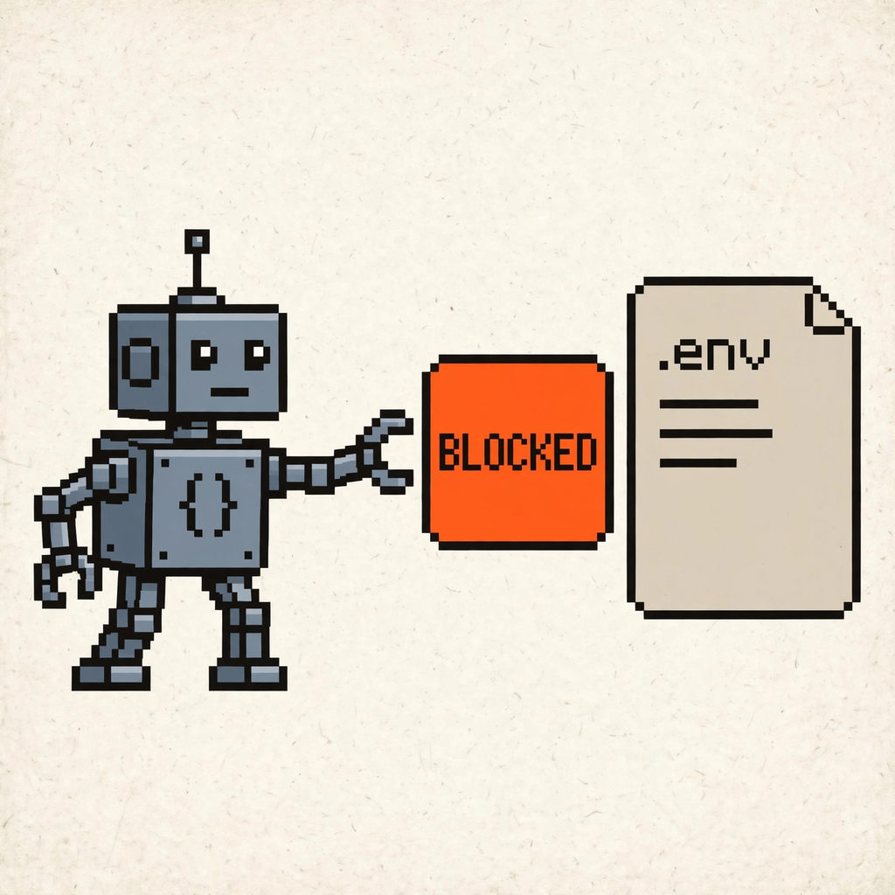
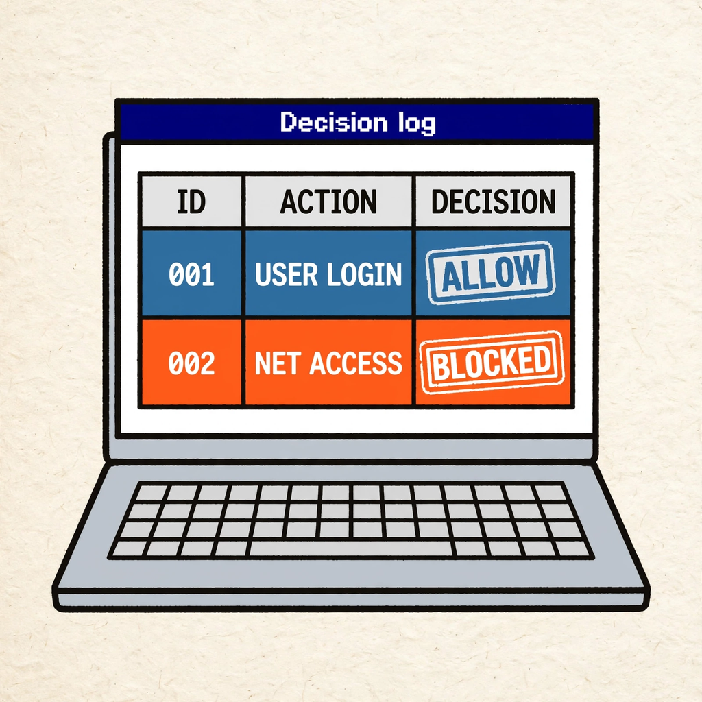
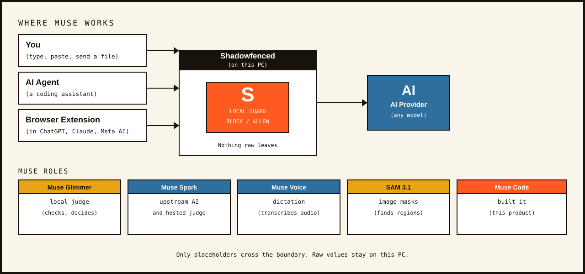

# Shadowfenced



[](https://github.com/wellytg/meta-hackathon-shadowfenced/actions/workflows/ci.yml)
[](LICENSE)
[](pyproject.toml)
[](docs/ARCHITECTURE.md)

A local guard between you (or your AI agents) and any AI. Sensitive details are checked on your machine before anything leaves.

[Live demo](LIVE_DEMO_URL) · [3-minute video](VIDEO_URL) · [Install in 3 steps](#install-in-3-steps-local)

## How it works in 8 pictures

Art: Meta Muse Image; prompts in `docs/assets/visual_prompts.yaml`, record in `docs/assets/generated/MANIFEST.md`. Captions below are README text, not image text.

<table>
<tr>
<td width="25%"><br><b>1. Typing</b> — an address and a codename sit in the draft.</td>
<td width="25%"><br><b>2. Underlines</b> — risky spans get wavy underlines as you type.</td>
<td width="25%"><br><b>3. Risk card</b> — Sending, Why it's risky, and What was done.</td>
<td width="25%"><br><b>4. Placeholders</b> — tags cross to the AI; raw values stay put.</td>
</tr>
<tr>
<td><br><b>5. Answer</b> — the reply returns with real values restored locally.</td>
<td><br><b>6. Clauses</b> — contract language travels as CONTRACT_CLAUSE tags.</td>
<td><br><b>7. Agents</b> — a coding agent reaching for .env is stopped.</td>
<td><br><b>8. Log</b> — each decision lands in a hash-chained log.</td>
</tr>
</table>

## Where Muse works



| Model | Job in this repo |
|---|---|
| Muse Glimmer | Local judge: ambiguous spans, people-search intent, residual-inference check, screenshot regions |
| Muse Spark | Upstream AI; hosted-demo judge fallback when Ollama is unreachable |
| Muse Voice | Dictation mic and audio-upload transcription (opt-in) |
| SAM 3.1 | Exact masks for screenshot redaction (opt-in cloud step) |
| Muse Image | All README and storyboard art |
| Muse Code | Built each feature from briefs in parallel agents |
| Llama 3.2 | Local stand-in upstream; fine-tune student (`docs/FINETUNE.md`) |

## Features

Live underlines. The console scans each keystroke through `POST /api/scan` with Tier 1 code detectors and underlines risky spans like a grammar checker for secrets; an optional live-model hint stays off by default.

`Tier 1 code · checked as you type` · `tests: tests/test_holds.py`

The risk card. Sending shows one row per decision: Sending (what would cross), Why it's risky, and What was done; clean messages get the receipt "Checked · nothing sensitive".

`code + Muse Glimmer · evidence card` · `tests: tests/test_t38b_states.py`

Provider keys and secrets in any encoding. Planted canaries (exact, base64, hex, rot13, reversed, URL-encoded, split) and provider key shapes BLOCK the send, so nothing is forwarded.

`Tier 1 code · canary + key shapes` · `tests: tests/test_t47_provider_keys.py`

Placeholders restored locally. Proven PII and business details become tags such as `[PII_EMAIL_1]`; the map lives in server memory on this PC with a 15-minute TTL and is restored into answers before display.

`code · 15-minute local map` · `tests: tests/test_redact.py`

Contract clauses (`[CONTRACT_CLAUSE_n]`). Numbered clauses and party lines redact to placeholders and restore locally; a stamped confidential agreement holds for a person instead.

`Tier 1 code · clause markers` · `tests: tests/test_t44_contract.py`

Documents. Bank statements, payslips, medical records, and contracts from `corpus/documents/` raise doc-type warnings that name the risk; the warning never blocks by itself.

`code · doc-type warnings` · `tests: tests/test_t29.py`

Re-identification + Generalise. Quasi-identifier combinations (name plus birthday, Sweeney-type triples) score as risky even when each field looks harmless; the banner offers a one-click Generalise that coarsens fields per `docs/REID.md`.

`code · combination scoring` · `tests: tests/test_reid.py`

People-search intent. Muse Glimmer reads the whole statement on this PC; a verified public-figure question (encyclopedic framing) is released, other person-search intent holds for review.

`Muse Glimmer · local judge` · `tests: tests/test_person_search.py`

Screenshot redaction (opt-in, cloud notice). Uploads need consent first: local mode fills Glimmer-found regions on this PC; exact SAM 3.1 masks run in the cloud, which receives the original image — the notice says so before you choose.

`Muse Glimmer + SAM 3.1 · opt-in` · `tests: tests/test_image_redact.py`

Dictation and audio (Muse Voice, opt-in). The mic button asks consent first ("Your voice is sent to Meta to be turned into text"), records WAV in the browser, and posts to `POST /api/transcribe`; audio uploads are transcribed then scanned like documents, and fail closed.

`Muse Voice · opt-in` · `tests: tests/test_t34_dictation.py`

Agent gate for coding agents. An OpenAI-compatible proxy at `POST /v1/chat/completions` gates tool-calling agents: BLOCK answers 403, HOLD answers 409 with a review URL, and protected keys are matched by salted fingerprints so values stay out of logs.

`code · OpenAI-compatible proxy` · `tests: tests/test_keyguard.py`

Browser extension (Chrome, Edge, Firefox; local test page). One codebase guards chatgpt.com, claude.ai, gemini.google.com, and meta.ai with page-local checks against the local app; the release manifests match only those sites, and a dev build adds a local test page.

`code · page-local checks` · `tests: tests/test_ext_api.py`

Providers (API keys in the OS keychain). Keys are pasted once and kept in the OS credential store (or git-ignored `.env`); the switcher offers Meta Muse Spark (cloud) or Llama 3.2 3B via Ollama (local stand-in), greyed out when no key is set.

`code · OS key store` · `tests: tests/test_t35_providers.py`

System status panel and hash-chained decision log. The console Details drawer reads `GET /api/health/components`; each decision is appended to a hash-chained JSONL log holding fingerprints, not raw values, with a verify endpoint.

`code · hash-chained log` · `tests: tests/test_ecs_log.py`

Hosted demo mode. With `SF_HOSTED=1` the same app shows a "Public demo. Use made-up data only." banner, keeps custom rules in memory, caps uploads, rate-limits clients, and judges Tier 2 with Muse Spark when local Ollama is unreachable — no GPU needed.

`Muse Spark · hosted judge fallback` · `tests: tests/test_hosted.py`

## Results

Sealed-set methodology: the holdout set was written without access to detector source (`corpus/holdout.yaml` header); the final set is the independent set held for after tuning (`corpus/final.yaml` header, `docs/muse-briefs/T48.md`). Each eval writes `runs/eval_<date>_<corpus>_<judge>.json` (`scripts/eval.py`).

Final set, full pipeline (`docs/results/eval_final_run2.json`, `python scripts/eval.py --corpus final --judge glimmer`): 40 cases (26 sensitive, 14 benign). 26 of 26 sensitive cases were stopped, redacted, or held — none sent as-is; 3 of 26 show partial redaction gaps in the outbound text. 4 of 14 benign cases were held for a person. 22 of 40 settled by code alone, 3 of 40 by Glimmer-plus-code, 15 of 40 by a person.

Holdout set (`docs/results/eval_holdout_glimmer.json`, `python scripts/eval.py --corpus holdout --judge glimmer`): 30 cases; 20 of 20 sensitive caught, 1 of 20 leaked, 3 of 10 benign held. Code-only ablation (`docs/results/eval_holdout_codeonly.json`, `python scripts/eval.py --corpus holdout --judge none`): 16 of 20 caught, 2 of 20 leaked, 2 of 10 benign held.

Tier 1 timing: Tier-1 gate latency in `docs/results/eval_final_run2.json` is p50 0.44 ms, p95 0.81 ms, max 3.0 ms (n=22); the under-20 ms check on 4 KB input is `python -m pytest tests/test_tier1.py -q`. Live Glimmer timing per check is `python scripts/time_glimmer.py` (`scripts/time_glimmer.py` usage; needs a live Ollama).

## Limits

- Pseudonymisation, not anonymisation: placeholders map back for 15 minutes on this PC, and field combinations can still single someone out — use Generalise (`docs/REID.md`).
- What Glimmer can miss: the final run shows 3 of 26 sensitive cases with partial redaction gaps (`docs/results/eval_final_run2.json`); names without context words and lowercase prose addresses are the known weak spots (`docs/gates/P1_DESIGN.md` in `docs/gates/`).
- Cloud steps send originals to Meta when turned on: SAM 3.1 exact masks receive the screenshot, Muse Voice receives dictation and audio uploads, and the hosted demo judges with Muse Spark (`src/shadowfenced/image_redact.py` notice, `src/shadowfenced/static/dictation.js` notice, `deploy/README.md`).
- Local Glimmer speed: warm decisions take around 6–12 s (`docs/gates/P3_SPIKE_NOTES.md`); the final eval review step measured p50 10666.37 ms (`docs/results/eval_final_run2.json`), and the shared timeout is 45 s (`.env.example`). Ambiguous sends HOLD instantly and review in the background, so typing never waits.

## Built with parallel Muse Code agents

56 briefs in `docs/muse-briefs/` drove the build, one feature slice at a time. Each cycle ran: brief → key-free clone → tests outside the agent sandbox plus the local CI gate → pull request with CI (`python -m pytest -q` on Python 3.11 and 3.12 via `.github/workflows/ci.yml`). Verification rested on the independent holdout and final sets above, which tuning never saw. Map of the result: `docs/ARCHITECTURE.md`.

## Install in 3 steps (local)

Requires Python 3.11+ (`pyproject.toml`) and [Ollama](https://ollama.com) with `muse-glimmer:30b` (plus `llama3.2:3b` for the local stand-in).

```powershell
pip install -e ".[dev]"
Copy-Item .env.example .env        # add META_API_KEY to use Muse Spark; .env is gitignored
ollama pull muse-glimmer:30b
python -m uvicorn shadowfenced.app:app --app-dir src --host 127.0.0.1 --port 8765
# open http://127.0.0.1:8765
```

Docker: `docker compose up --build` (`compose.yaml`); with the local judge profile add `OLLAMA_URL=http://ollama:11434` to `.env`, pull the model once, and start with `docker compose --profile local-glimmer up --build` (`Dockerfile` runs uvicorn on 8765).

Extension: run `python extension/build.py`, then Chrome/Edge → `chrome://extensions` → Developer mode → Load unpacked → `extension/dist/chrome`; Firefox → `about:debugging` → This Firefox → Load Temporary Add-on → any file in `extension/dist/firefox` (full steps in `extension/README.md`).

Modal demo note: `modal deploy deploy/modal_app.py` with a `shadowfenced-meta` secret holding the Meta key serves the hosted demo (`SF_HOSTED=1`); a Hugging Face Docker Space with `META_API_KEY` plus `SF_HOSTED=1` works the same — neither is needed for local use (`deploy/README.md`).

## Repo map

- `src/shadowfenced/` — gate, detectors, judges, providers, console (`static/`)
- `extension/` — browser extension, local test page (`testpage/`), build script
- `scripts/` — eval, timing, fine-tune pipeline, visuals, demo video
- `corpus/` — synthetic sets (`cases.yaml`, `holdout.yaml`, `final.yaml`, `documents/`, `reid.yaml`, `person_search.yaml`)
- `docs/` — `ARCHITECTURE.md`, `REID.md`, `FINETUNE.md`, gates, briefs, assets, `results/`
- `tests/` — one file per module plus repo-guard, API, and eval tests
- `policy.yaml`, `.env.example`, `compose.yaml`, `Dockerfile`, `deploy/`

## Licence

Apache-2.0 — see [LICENSE](LICENSE).

## Credits

Meta models (see `docs/ARCHITECTURE.md`): Muse Glimmer (local judge), Muse Spark (upstream AI, hosted judge fallback), Muse Voice (dictation and audio transcription), SAM 3.1 (screenshot masks), Muse Image (README and storyboard art), Muse Code (built the product from the briefs); Llama 3.2 as the local stand-in and fine-tune student. Other tools used during development: Python, FastAPI, uvicorn, httpx, truststore, Pydantic, PyYAML, Pillow, python-multipart, python-docx, pypdf, keyring, Ollama, Piper TTS (LJSpeech voice) for demo narration, Playwright for demo scenes, Modal and Hugging Face Spaces as interchangeable demo hosts.
