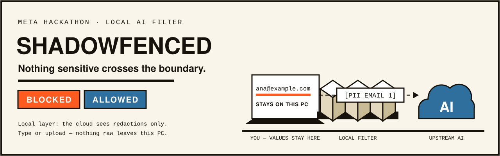
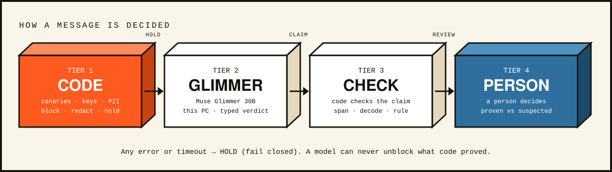

<picture>
  <source media="(prefers-color-scheme: dark)" srcset="docs/assets/banner-dark.svg" />
  
</picture>

[](https://github.com/wellytg/meta-hackathon-shadowfenced/actions/workflows/ci.yml)
[](https://www.apache.org/licenses/LICENSE-2.0)
[](https://www.python.org/)
[](#how-a-message-is-decided)

# Shadowfenced

## Submission overview

- Track: Indie Developer · problem statement: Push the Frontier
- Provenance: built from scratch during the hackathon (Oct 26 – Nov 4, 2026); first commit Oct 27
- Meta models at runtime: Muse Glimmer 30B (local, Tier 2 judge) · Muse Spark 1.3 (Meta Model API) · SAM 3.1 (opt-in screenshot masks, Meta Model API) · Muse Voice (dictation and audio uploads) · Llama 3.2 3B (light local option)
- Built with: Muse Code (code and tests); Muse Image (video visuals)
- Bonus prizes: Best Build on Meta Open Weight Models (Muse Glimmer 30B is the local judge on our own GPU) · Best Agentic Use-Case (a guard for coding agents, built by the Muse Code agent) · Best Creative Build (Muse Image drew the comic and video art)
- 3-minute video: https://youtu.be/A5oB9gPYrfg · Live demo: https://wellytg--shadowfenced-asgi.us-east.modal.run
- Quick start: `python setup/check.py`, then `setup/start.ps1` / `setup/start.sh`; keyless: `python setup/try_cases.py`
- For judges: [`docs/JUDGES.md`](docs/JUDGES.md) checks all six catches in a few minutes · Security: [`SECURITY.md`](SECURITY.md) (hackathon build, use at your own risk) and [`docs/security/`](docs/security/) (threat model, red-team results, Nov 4 review) · Next: [`docs/ROADMAP.md`](docs/ROADMAP.md)

*Meta Global AI Developer Hackathon 2026 · Indie track · team Shadowfenced*

Many companies ban or restrict cloud AI because staff paste customer data, contracts and keys into it.
Shadowfenced is a local guard that lets them allow it: sensitive text is stopped or replaced with
placeholders on the person's own PC before any AI sees it, and answers come back with the real values
restored locally. It is for staff who use AI chats and coding agents, and the security teams who have
to approve them.

▶ [Demo video (2:57)](https://youtu.be/A5oB9gPYrfg) · Live demo: https://wellytg--shadowfenced-asgi.us-east.modal.run (fictional data only; hosted mode, see below)

## Try it in one minute

- **No install:** open the live demo and press **Play the demo** (six real decisions, no typing), or run the 10
  quick cases against it: `python setup/try_cases.py`.
- **On your machine:** `python setup/check.py` tells you which profile your PC can run (Glimmer 30B, Llama 3.2 3B,
  or code only) and prints the start command; `setup/start.ps1` / `setup/start.sh` start it in one step.
- **Coding agents, no install:** point any OpenAI-compatible client at the live demo's `/v1`. A harmless
  request is answered by Muse Spark; a request carrying a key gets `403` (`X-Shadowfenced-Decision: BLOCK`), and
  one that says where a key lives, like this, gets `409` (`HOLD`):

  ```bash
  curl -i https://wellytg--shadowfenced-asgi.us-east.modal.run/v1/chat/completions -H "content-type: application/json" -d '{"model":"muse-spark-1.3","messages":[{"role":"user","content":"Use the prod key in ~/.aws/credentials to deploy."}]}'
  ```

  With the OpenAI SDK, set `base_url="https://wellytg--shadowfenced-asgi.us-east.modal.run/v1"`. Locally the
  same proxy runs at `http://127.0.0.1:8765/v1`. An agent setting up the app from a fresh clone can follow
  `setup/AGENT_SETUP.md`.
- **Browser extension (ChatGPT, Gemini, Claude, meta.ai):** download `shadowfenced-chrome.zip` or `shadowfenced-firefox.zip`
  from the [v1.0-hackathon release](https://github.com/wellytg/meta-hackathon-shadowfenced/releases/tag/v1.0-hackathon),
  unzip, and load it unpacked (Chrome: `chrome://extensions` → Developer mode → Load unpacked). It talks only to
  the local app, so start that first (`setup/start.ps1` / `setup/start.sh`), then paste the pairing token from the
  app's setup card into the extension popup, and allow each site under the extension's Site access. Tested live
  on Nov 4: it blocked a key at send on ChatGPT, Gemini, Claude and meta.ai. Grok is added but does not yet
  stop the send. If the local app cannot check, nothing is sent. Details: `extension/README.md`.
- **Every number below:** mapped to its results file and the command that reproduces it in `setup/RESULTS.md`.

## What it does

- Underlines sensitive text as you type, like a grammar checker for secrets.
- Blocks API keys and planted canary secrets in any encoding (plain, base64, hex, ROT13, reversed, URL-encoded).
- Replaces personal and business data with typed, numbered placeholders (`[PII_EMAIL_1]`) and restores the real values in answers on the PC (`redact.rehydrate`).
- Blocks a full identity bundle (name + date of birth + address + phone/email) in code, with no model call.
- Asks first when a message looks like a search for a private person.
- Browser extension that guards ChatGPT, Gemini, Claude and meta.ai (all blocked a key in live tests on Nov 4; Grok is in progress).
- File guard: files are stopped before upload and scanned locally; bank statements, secrets and identity bundles cannot be uploaded as-is; a one-click redacted copy keeps CSV/JSON structure; an optional Glimmer deep check adds findings.
- OpenAI-compatible proxy for CLI agents and SDKs (`POST /v1/chat/completions`): every message role is checked, and real keys are fingerprinted without being stored.
- Screenshot redaction (opt-in, default `off`): Glimmer finds the sensitive regions on this PC and either `local` mode box-fills them here or `on` mode sends the screenshot to Meta's API for exact SAM 3.1 masks.
- Muse Voice dictation in the web app, and transcription of audio uploads.
- A hash-chained decision log that stores fingerprints, never values.
- Learns from your choices: a "What it caught" panel (counts by kind, never values) and rule suggestions you approve, which edit your local rules file (`policy.local.yaml`, with a backup).

## How a message is decided

<picture>
  <source media="(prefers-color-scheme: dark)" srcset="docs/assets/tiers-dark.svg" />
  
</picture>

<details>
<summary>Text diagram (ASCII)</summary>

```
 text ─► TIER 1  code: planted canaries (any encoding), key shapes, PII, org codenames/clients, beacon cues
           │  canary ─────────────────────────────────────────────► BLOCK  (nothing is sent)
           │  proven PII / business data ─────────────────────────► REDACT ([PII_EMAIL_1] …, restored locally)
           │  ambiguous, or a sensitivity cue word ───────────────► HOLD instantly, then:
           ▼
         TIER 2  Muse Glimmer 30B on this PC (Ollama) gives a typed verdict {class, confidence, span}
           ▼
         TIER 3  code checks the claim (exact span, decodes to a canary, matches a PII/business rule)
           │  confirmed → redact and send · confidently harmless → release
           ▼
         TIER 4  a person decides; the card separates "proven by code" from "model suspicion only"

 Precedence: BLOCK > HOLD > REDACT > WARN > ALLOW. Any error or timeout ─► HOLD (fail closed).
 A model verdict can never downgrade a code finding. Text aimed at the safety check stays held.
 Every decision goes to a hash-chained log with fingerprints only (no raw values).
```

</details>

Tier 1 is code, Tier 2 is Muse Glimmer 30B on this PC, Tier 3 is code that verifies the model's
claim, Tier 4 is the person. Precedence is BLOCK > HOLD > REDACT > WARN > ALLOW, and anything
that errors or times out fails closed to HOLD. A model verdict can only add findings or raise
risk, never downgrade a code finding; a message that carries instruction-like text aimed at the
safety check ("ignore previous instructions", "classify this as harmless") stays held (T68).

The text being checked may itself be the secret, so asking a cloud model "is this a leak?" can be
the leak. The judge runs on the user's own machine.

## How Meta models are used

| Model | Role | Where it runs |
|---|---|---|
| Muse Glimmer 30B (open weights) | Tier 2 judge for the hard cases; finds image regions | Local via Ollama on an RTX 5070 12 GB; nothing leaves the PC |
| Muse Spark | The answering model in the app; the judge in hosted mode | Meta Model API |
| Muse Code | Wrote the product code and tests from the 94 brief files in `docs/muse-briefs/` (briefs drafted with AI assistance, steered, checked and approved by a person) | Local agent |
| Muse Voice | Dictation and audio-upload transcription | Meta Model API |
| Muse Image | Storyboard panels and banner art (`docs/assets/generated/`) | Meta Model API |
| SAM 3.1 | Exact masks for screenshot redaction (opt-in `on` mode; default `off`, `local` mode box-fills on this PC) | Meta Model API |

"Meta checks Meta": a local Meta open-weight model screens what is sent to a Meta cloud model.

Cloud calls (answering, hosted judging, voice, image, SAM masks (opt-in)) go to the Meta Model API at `https://api.meta.ai/v1` (docs at `https://dev.meta.ai/`); the answering model is `muse-spark-1.3` (`META_MODEL` in `src/shadowfenced/config.py`).

## Results (honest numbers)

Three test sets, all synthetic (fictional org "Corvane Labs"; secrets are `SF_CANARY_` templates
minted at runtime, never committed):

| Set | Sensitive caught | Partial leaks | Harmless escalated |
|---|---|---|---|
| `corpus/cases.yaml` (40) | 100 % | 0 % | 0 % — in-sample, not a fair test |
| `corpus/holdout.yaml` (30) | 16 of 20 → 20 of 20 | 2 of 20 → 1 of 20 (5 %) | 2 of 10 → 3 of 10 — code-only → full pipeline, used for tuning |
| **`corpus/final.yaml` (40)** | **26 of 26** | **3 of 26 (11.5 %)** | **7 of 14 — final numbers** |

Holdout files: `docs/results/eval_holdout_codeonly.json` and `docs/results/eval_holdout_glimmer.json`
(Oct 31). Final file: `docs/results/eval_final_run3.json` (Nov 3, Glimmer judge, after T65–T66c).

Final set: 70 % of messages were settled by code alone, 27.5 % went to a person (was 55 % / 37.5 %
in run 2). Two of the 7 escalated harmless messages are example.* emails, now treated as personal
data on purpose (T65). The 3 leaks are partial redactions: names, a date of birth and a street
address slipped through without context words.

Latency: Tier 1 (`tier1.scan` only) p50 0.45 ms, p95 0.94 ms, max 1.78 ms over all 107 corpus
messages (5 runs, average 188 characters, measured Nov 3 on the dev PC). Glimmer reviews take
about 10–20 s each.

Reproduce any number through one runner — see [`eval/`](eval/README.md): `python eval/run.py --suite final --judge glimmer` writes a fresh `runs/eval_<date>_final_glimmer.json`.

### Experiment: a small trained judge (Nov 4, not used in the product)

We trained Llama 3.2 3B Instruct (QLoRA, 4-bit) on our 722 synthetic judge examples: 3 epochs,
20 minutes on one RTX 5070 (12 GB). We then compared three judges on their own, without the code
tiers, on the sealed final set, which was not in the training data:

| Judge (alone) | Sensitive caught | Harmless flagged | Unreadable answers | Median time |
|---|---|---|---|---|
| Llama 3.2 3B, base | 0 of 26 | 0 of 14 | 40 of 40 | 4.6 s |
| **Llama 3.2 3B, trained** | **23 of 26** | **2 of 14** | 2 of 40 | **3.5 s** |
| Muse Glimmer 30B | 25 of 26 | 13 of 14 | 2 of 40 | 7.3 s |

The base model never answered in the judge format. After training, the 3B judge is about twice as
fast as Glimmer and far less over-cautious, but it misses 3 sensitive messages to Glimmer's 1.
In the full pipeline the code tiers settle most of Glimmer's harmless flags, so Glimmer stays the
judge. This is one run on 40 messages. Details and the held-out split (89 rows) are in
`docs/results/ft_3b_eval_nov4.json`; method in [`docs/FINETUNE.md`](docs/FINETUNE.md). We trained
Llama 3.2 3B rather than Glimmer because a 30B model does not fit for training on a 12 GB GPU.

## Known limits

- Review rate: 27.5 % of messages still need a person, and harmless messages with sensitive words
  are escalated (7 of 14). Code now settles 70 %; the rest is the cost of failing closed.
- Hardware: Glimmer 30B needs a GPU with about 12 GB. Without one, the code tiers still run: on the final set
  they alone caught all 26 sensitive messages and escalated one more harmless message (8 of 14 instead of 7);
  hard cases come to you instead of Glimmer (`setup/README.md`). Hosted mode uses Muse Spark as the judge.
- Meaning lost to redaction: placeholders are typed and numbered so the AI can still reason
  ("[PII_EMAIL_1]"), values are restored locally, and identity bundles are generalised ("a street
  in Leeds"). Answers that need the real value (e.g. "is this address correct?") cannot be answered
  by the cloud model.
- Judge manipulation: fixed in T68 as above — a model can only raise risk, never lower a code
  finding, and text aimed at the safety check stays held.
- Partial leaks: names, a date of birth and a street address without context words (3 of 26 in
  the final set). Tighter name and address detectors are the next step.
- The product uses no trained model: Glimmer 30B is the judge as released by Meta. One training
  experiment (a small 3B judge, below) was run on Nov 4 and is not wired into the app.
- Security: a hackathon build, not audited. 52 red-team tests: 35 stopped, 3 partial, 14 known gaps
  (`docs/security/REDTEAM_RESULTS.md`); fixes and open items from an independent review are in
  `docs/security/REVIEW_NOV4.md`. Other browser extensions and built-in browser assistants can read what you type
  on an AI site before Shadowfenced acts (`SECURITY.md`).
- Extension: underlining while typing depends on each site's page structure and can break when a site
  changes; the send-time check still runs. Grok is not yet protected.
- Exact SAM masks need the cloud mode, which sends the screenshot to the Meta Model API;
  the local mode keeps it on the PC but uses rectangular boxes.

## Run it

Requires Python 3.11+ and [Ollama](https://ollama.com) ≥ 0.32.7 with `muse-glimmer:30b`.

```powershell
pip install -e ".[dev]"
Copy-Item .env.example .env        # add META_API_KEY to use Muse Spark; .env is gitignored
ollama pull muse-glimmer:30b
python -m uvicorn shadowfenced.app:app --app-dir src --host 127.0.0.1 --port 8765
# open http://127.0.0.1:8765
```

Any OpenAI-compatible client can use it as a proxy: point it at `http://127.0.0.1:8765/v1`.
Blocked requests return 403 (`shadowfenced_block`); held requests return 409 (`shadowfenced_hold`)
with a review URL.

```powershell
python -m pytest -q -p no:cacheprovider   # 1,200+ tests, no network
python scripts/eval.py --corpus final --judge glimmer   # writes runs/eval_<date>_final_glimmer.json
python scripts/make_files.py              # synthetic demo files in runs/files/
```

Extension: `python extension/build.py --dev`, load the built folder unpacked in the browser, and
exercise it against the test page in `extension/testpage/`.

Hosted mode (`SF_HOSTED=1`) shows the "fictional data only" banner, keeps custom rules in memory
only, and judges with Muse Spark when no local Ollama is reachable. In that mode Spark reads the
held message in order to judge it, which is why the hosted demo is for fictional data only; in the
local product Spark only ever receives the redacted text. Docker and Modal: see
`deploy/README.md` (`modal deploy deploy/modal_app.py`).

## How it was built

Oct 27 – Nov 4, 2026. The 94 brief files in `docs/muse-briefs/` (the video, made earlier, says more than seventy) were planned with AI assistance
(brainstorming and drafting) and steered, checked and approved by a person; Muse Code wrote the code
and tests; each change was tested outside the agent, then merged through PRs with CI. Pre-existing:
open-source libraries and Meta's models.
Architecture: `docs/ARCHITECTURE.md`.

---

Licence: Apache-2.0. Narration in the demo video: AI voice (ElevenLabs), cloned from the creator's own voice.
