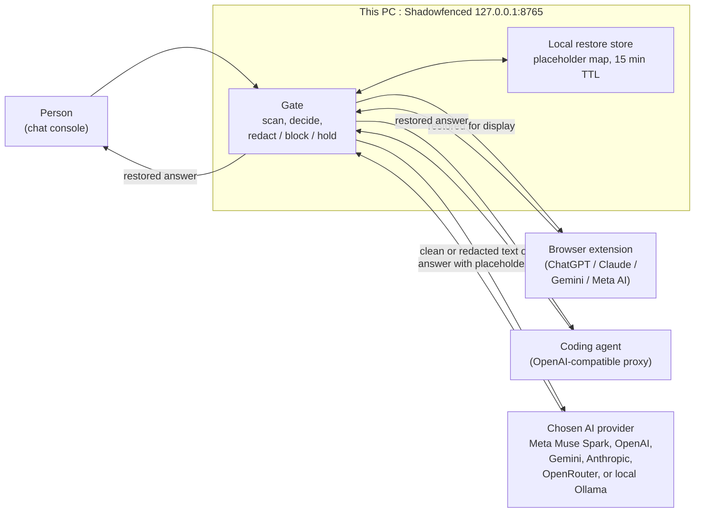
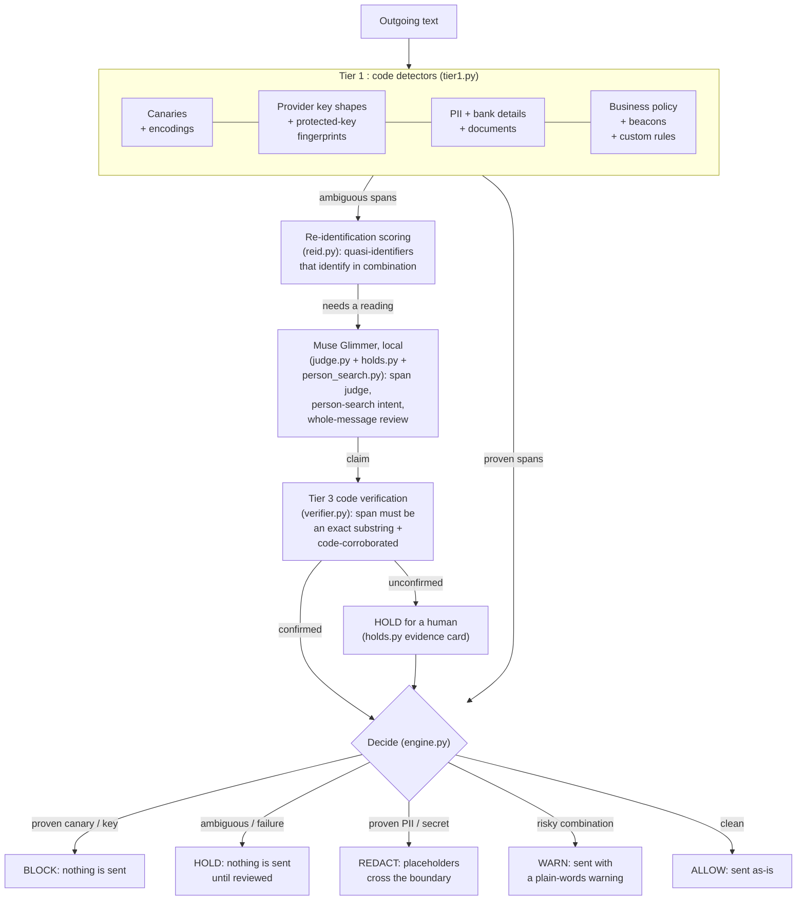
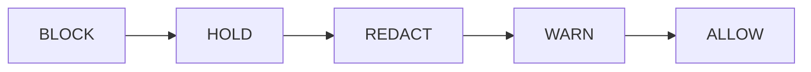
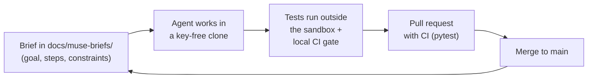

# Shadowfenced architecture

Shadowfenced is a local layer between a person and any AI. It runs on this
PC, scans outgoing text with deterministic code detectors, optionally asks a
local judge model about ambiguous spans, and only then forwards clean or
redacted text to the chosen AI provider. Answers come back through the same
layer, which restores the real values locally for display.

- Source of truth: `src/shadowfenced/` (Python), `src/shadowfenced/static/`
  (console UI), `extension/` (browser extension), `scripts/` (eval/finetune).
- Live status: open the console, expand the **Details** drawer, and read the
  **System status** card (served by `GET /api/health/components`).
- Secrets policy: keys live in the OS credential store or a git-ignored
  `.env`, never in the repo. `tests/test_repo_guard.py` fails the build if a
  provider key shape is ever tracked.

## 1. Request path

Three clients reach AI through the same local gate. Nothing sensitive crosses
the boundary except placeholders such as `[PII_EMAIL_1]`; the real values
stay in server memory on this PC for 15 minutes and are restored into answers
before display.

Endpoints: the console posts to `/api/scan` and `/api/send`; the extension
uses `/api/ext/scan`, `/api/ext/redact` and `/api/ext/rehydrate` (paired with
a token); coding agents speak OpenAI chat completions at
`/v1/chat/completions` (BLOCK answers 403, HOLD answers 409 with a
`review_url`). Uploads (`/api/upload`, audio transcribed first) join the
gated text at send time.

## 2. Decision pipeline

Tier 1 code detectors run first and are the only thing that can prove a
finding. Re-identification scoring, the local judge, and Tier 3 verification
refine ambiguous cases. The judge proposes; code disposes. Any internal
failure holds the message for a human (fail closed).

Precedence (first match wins):

Fail-closed paths: judge timeout / bad JSON / schema violation returns no
verdict; an unverified model claim holds; `engine.gate` wraps unexpected
errors as HOLD; unscannable uploads hold the send; transcription failure
marks the file unscannable instead of passing unchecked audio.

Glimmer call order on one send (T53): every local Glimmer text call
shares one timeout (`SF_GLIMMER_TIMEOUT_S`, default 45 s; image calls
keep the longer `SF_IMAGE_TIMEOUT_S`)
and the checks run in a fixed order, so a later call is skipped when an
earlier result already decides the outcome:

1. person-search intent (`person_search.py`, inline in the gate);
2. residual-context check (`reid.py`, tier-1/residual flows only; deferred
   in send mode);
3. whole-message judge (background review of send-mode HOLDs only).

Skip rules: a residual HOLD skips the person-search call; a verified
public-figure verdict lifts a pure cue-word HOLD to ALLOW so no
background review is queued; re-identification OK plus no person-search
trigger (or Tier 2 off) means no Glimmer call at all; WARN/ALLOW/REDACT
never queue a review. A send-mode HOLD is always reviewed — the
background judge never skips (fail closed).

## 3. Modules

One box per Python module and static script, each with its one-line job.
Model tags: **[Glimmer]** local judge via Ollama (`muse-glimmer:30b`),
**[Spark]** upstream cloud model via the Meta API (`muse-spark-1.3`, also the
hosted-demo judge fallback), **[Voice]** transcription
(`muse-voice-transcribe-1.0`), **[Llama]** local stand-in via Ollama
(`llama3.2:3b`: default local upstream + live underline hints). Untagged
boxes are deterministic code with no model.

```mermaid
flowchart TD
    subgraph Entry["Entry points"]
        App["app.py: FastAPI proxy<br/>scan, gate, forward, re-hydrate"]
        ExtAPI["ext_api.py: loopback API<br/>for the browser extension"]
        Rules["rules.py: custom org rules<br/>list / add / remove"]
        Health["health.py: component checks<br/>for the status panel"]
    end
    subgraph Core["Gate core (no model)"]
        Engine["engine.py: Tier-1-only gate<br/>findings in, decision out"]
        Tier1["tier1.py: deterministic detectors<br/>patterns, canaries, entropy, policy"]
        Canary["canary.py: runtime-minted<br/>fake secrets, never committed"]
        Policy["policy.py: load + validate<br/>policy.yaml"]
        Spans["spans.py: UTF-16 span offsets<br/>for the API contract"]
        Redact["redact.py: placeholders<br/>+ tolerant re-hydration"]
        Keyguard["keyguard.py: recognise protected<br/>keys without keeping them"]
        Verifier["verifier.py: Tier 3 check<br/>model proposes, code disposes"]
        Reid["reid.py: combination risk<br/>scoring, generalised text"]
    end
    subgraph Models["Model-backed (local first)"]
        Judge["judge.py [Glimmer]:<br/>ambiguous-span verdicts,<br/>~300-char window only"]
        Holds["holds.py [Glimmer]:<br/>async whole-message review<br/>+ evidence card data"]
        PS["person_search.py [Glimmer]:<br/>person-search intent reading"]
        Transcribe["transcribe.py [Voice]:<br/>audio uploads to text"]
        Upstream["upstream.py [Spark] [Llama]:<br/>forward redacted text to<br/>any OpenAI-compatible AI"]
        Providers["providers.py [Spark]:<br/>registry + OS key store<br/>+ OpenRouter PKCE"]
        Hosted["hosted.py [Spark]:<br/>hosted demo mode;<br/>Spark judges when<br/>Ollama is unreachable"]
    end
    subgraph State["Local state (no model)"]
        Log["ecs_log.py: hash-chained<br/>JSONL decision log"]
        Stats["stats.py: counters derived<br/>from the log file"]
        Uploads["uploads.py: in-memory file<br/>store, 15 min TTL"]
        Extract["extract.py: upload bytes<br/>to gated text"]
        Docclass["docclass.py: document-type<br/>warnings, never blocking"]
        Corpus["corpus.py: synthetic eval<br/>values minted at runtime"]
        Config["config.py: env + .env settings;<br/>values never logged"]
    end
    App --> Engine
    App --> Upstream
    App --> Health
    ExtAPI --> Engine
    Engine --> Tier1
    Engine --> Reid
    Engine --> Redact
    Holds --> Judge
    Holds --> Verifier
    PS --> Reid
    Judge -.->|"no verdict on failure"| Holds
    App -.->|"append + verify"| Log
    Providers -.->|"keys"| Keyguard
```

Static console scripts (`src/shadowfenced/static/`):

- `app.js`: composer underlines, issue cards, receipts, drawer, status panel.
- `rules.js`: custom-rules drawer + descriptive-mode trace timeline.
- `reid.js`: re-identification banner with a one-click Generalise choice.
- `providers.js`: provider panel (paste a key; it stays on this computer).
- `dictation.js`: opt-in microphone button using Muse Voice; audio never stored.

Scripts (`scripts/`): `eval.py` (gated-text evaluation over the synthetic
corpus), `ft_label.py` / `ft_split.py` / `ft_generate.py` / `ft_train.py` /
`ft_eval.py` (rules-to-dataset fine-tune pipeline), `ci.py` (pytest +
compileall + tracked-file secret scan), `make_files.py`, `demo_video.py`.
Browser extension (`extension/src/`): `content.js` (in-page checking),
`background.js`, `adapters.js` (per-site adapters), `logic.js` (shared gate
logic), `popup.js`. Deploy: `deploy/modal_app.py` (hosted demo without a GPU).

## 4. How it was built

Every change follows the Muse Code agent workflow:

The repo guard (`tests/test_repo_guard.py`, from T1) keeps every clone
key-free: full-length provider key shapes and a tracked `.env` fail the
build. Git history shows the pattern repeating — e.g. `Merge pull request
#12 from wellytg/feat/reid`, `Merge pull request #5 from wellytg/feat/rules`
— with feature commits tagged `(Muse Code)` and the task id.

Which tasks built which module (from `docs/muse-briefs/` and `git log`):

| Tasks | Built |
|---|---|
| T1 | Package rename, `pyproject.toml`, `.env.example`, `test_repo_guard.py` |
| T2–T3 | `canary.py`, `tier1.py`, `policy.py` |
| T4–T5 | `redact.py`, `engine.py`, `app.py` proxy, `upstream.py` |
| T6–T7 | Console thin slice, `ecs_log.py` hash-chained log, `stats.py` |
| T8–T9 | `judge.py` [Glimmer], `verifier.py` Tier 3 |
| T9fix–T10 | Minimal judge schema, `holds.py` async review [Glimmer] |
| T12–T13 | `uploads.py`, `extract.py`, provider switch, HOLD polish |
| T13b–T15 | Meta TLS fixes, `corpus.py`, `scripts/eval.py` |
| T16, T16b | Detector tuning; Glimmer whole-message review, 3B screen dropped |
| T19 | CI workflow, `scripts/ci.py`, licence |
| T21, T21b | `rules.py`, `rules.js` descriptive trace, route fix |
| T22 | OpenAI-proxy gate, `keyguard.py` protected keys |
| T25 | `hosted.py`, Dockerfile/compose, `deploy/modal_app.py` |
| T26 | `ft_*.py` fine-tune pipeline |
| T27 | `transcribe.py` [Voice] audio uploads |
| T28 | `examples/agent_demo.py` tool-calling demo |
| T29 | Bank-detail detectors, `docclass.py` |
| T30, T30b, T30c | `reid.py` combination risk |
| T31, T31b, T32 | Chat shell, Classic design (`app.js`, `style.css`) |
| T33 | `person_search.py` intent [Glimmer] |
| T34 | `dictation.js` voice dictation [Voice] |
| T35 | `providers.py` keychain registry, `providers.js` |
| T36 | `extension/*`, `ext_api.py` |
| T40 | This map, `health.py`, System status panel |
